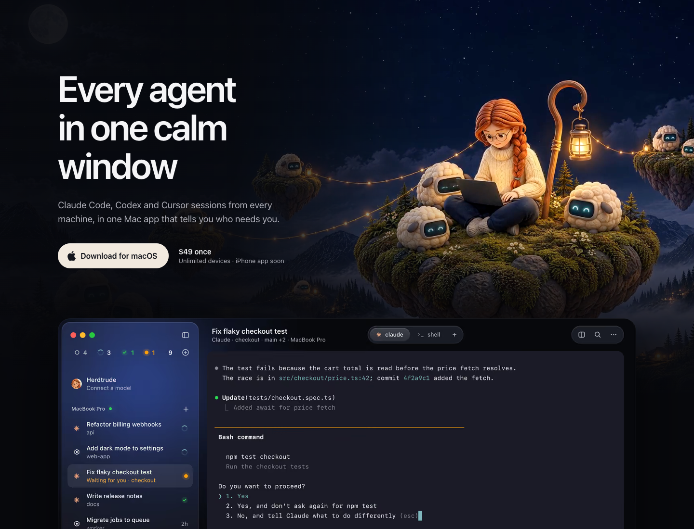
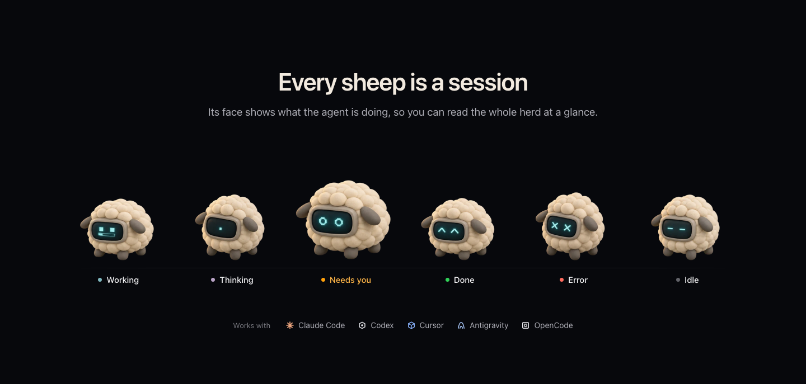
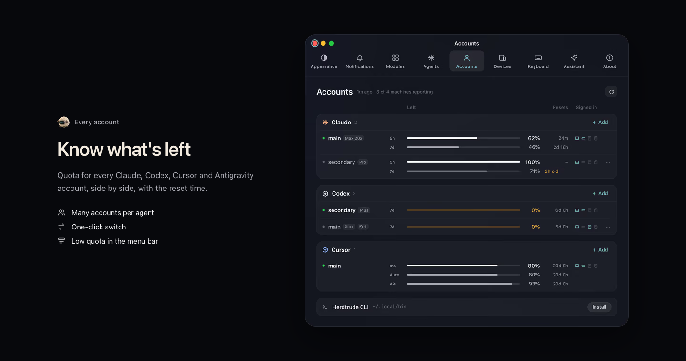

<h1 align="center">Herdtrude</h1>

<strong>Every coding agent, on every machine, in one window</strong>

<a href="https://herdtrude.app">Website</a> · <a href="https://youtu.be/cTN3b94vSqA">Watch 46s demo</a> · <a href="https://github.com/deeflect/herdtrude/releases/latest">Download Beta (macOS / Linux)</a> · <a href="https://github.com/deeflect/herdtrude/issues/new?template=bug_report.yml">Report a bug</a> · <a href="https://github.com/deeflect/herdtrude/issues/new?template=feature_request.yml">Request a feature</a>

  

Herdtrude is a desktop app for people who run coding agents such as Claude Code, Codex, Cursor, Antigravity or OpenCode across multiple terminals and machines. It shows every session in one window, alerts you when an agent pauses on an approval prompt, and tracks quota across accounts.

> **Beta & Open Source:** Herdtrude is **free during beta** with no licence key required. Source code is being cleaned up and will be published in this repository under **AGPL-3.0** soon.

## Download

Grab the latest signed beta installer directly from **[GitHub Releases](https://github.com/deeflect/herdtrude/releases/latest)**:

- **macOS (Apple silicon):** `Herdtrude_0.2.1_aarch64.dmg`
- **Linux (x64 .deb):** `Herdtrude_0.2.1_amd64.deb`

In-app auto-updates pull signed updates from GitHub Releases.

## Features

### Every session as a sheep

Each session is drawn as a sheep whose face shows its state: working, thinking, needs you, done, error or idle.

### Needs-you alerts

When an agent stops to ask, a menu-bar sheep, a corner pet with Allow and Deny, and an alert that names the session tell you which one. An optional sound can chime too.

### All your machines

Add a Mac or a server over SSH and its sessions join your sidebar, grouped by machine and project. They keep running when you quit the app.

### Quota across accounts

Quota for every Claude, Codex, Cursor and Antigravity account sits side by side with its reset time. You can keep many accounts per agent and switch with one click.

### Insights on token use

Tokens per agent, per machine and per day appear with what they would cost at API prices. A burn rate shows whether the week's quota will last.

### Clickable terminal output

Files, line numbers, URLs and commit hashes in agent output become links. Hover to peek, or Command-click to open your editor at the line.

## Questions

### Which coding agents does Herdtrude work with?

Herdtrude works with Claude Code, Codex, Cursor, Antigravity and OpenCode.

### Is there a Herdtrude iPhone app?

Not yet. An iPhone app that pairs by QR code is listed as coming soon.

### Can I script Herdtrude from a shell?

Yes. Herdtrude includes a command-line tool with `--json` output.

### When is the source code going public?

Soon—this repository will host the full **AGPL-3.0** source once the release cleanup finishes. Until then, signed beta binaries and issue tracking live right here.

## Feedback

Please [open an issue](https://github.com/deeflect/herdtrude/issues) for a bug or a feature request. I read every one. A useful bug report gives the app version, the system version and the steps that lead to the bug.

## Made by

Herdtrude is made by [Dmitry (Dee) Kargaev](https://www.deeflect.com) (`deeflect`).
