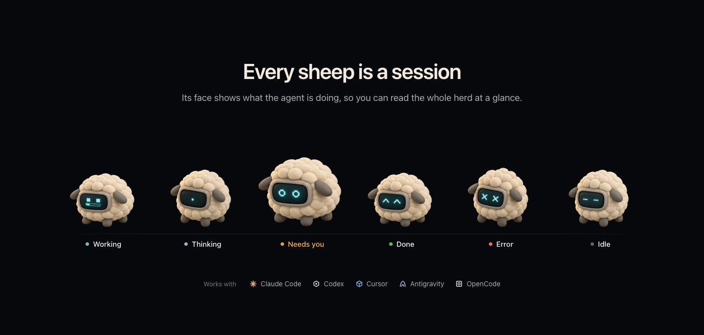
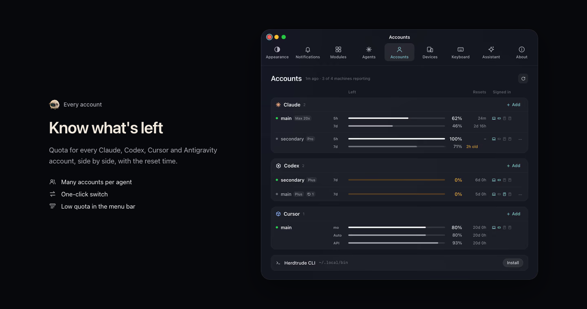

<h1 align="center">Herdtrude</h1>

<strong>A Mac app for your coding agents</strong>

<a href="https://herdtrude.app">Website</a> · <a href="https://api.herdtrude.app/download/latest/mac">Download for Mac</a> · <a href="https://github.com/deeflect/herdtrude/issues/new?template=bug_report.yml">Report a bug</a> · <a href="https://github.com/deeflect/herdtrude/issues/new?template=feature_request.yml">Request a feature</a>

 

Herdtrude is a Mac app for people who run coding agents such as Claude Code or Codex. It shows every session on all your machines in one window and tells you which agent needs you. The price is $49, paid once, and it covers every Mac you own.

## Features

### Every session as a sheep

Each session is drawn as a sheep whose face shows its state: working, thinking, needs you, done, error or idle.

### Needs-you alerts

When an agent stops to ask, a menu-bar sheep, a corner pet with Allow and Deny, and an alert that names the session tell you which one. An optional sound can chime too.

### All your machines

Add a Mac or a server over SSH and its sessions join your sidebar, grouped by machine and project. They keep running when you quit the app.

### Quota across accounts

Quota for every Claude, Codex, Cursor and Antigravity account sits side by side with its reset time. You can keep many accounts per agent and switch with one click.

### Insights on token use

Tokens per agent, per machine and per day appear with what they would cost at API prices. A burn rate shows whether the week's quota will last.

### Clickable terminal output

Files, line numbers, URLs and commit hashes in agent output become links. Hover to peek, or Command-click to open your editor at the line.

## Download

Buy Herdtrude for Mac at [herdtrude.app](https://herdtrude.app). The $49 price is paid once and covers every Mac you own.

## Questions

### Which coding agents does Herdtrude work with?

Herdtrude works with Claude Code, Codex, Cursor, Antigravity and OpenCode.

### Is there a Herdtrude iPhone app?

Not yet. An iPhone app that pairs by QR code is listed as coming soon.

### Can I script Herdtrude from a shell?

Yes. Herdtrude includes a command-line tool with `--json` output.

## Feedback

Please [open an issue](https://github.com/deeflect/herdtrude/issues) for a bug or a feature request. I read every one. A useful bug report gives the app version, the system version and the steps that lead to the bug.

## Made by

Herdtrude is made by [Dee (deeflect)](https://deeflect.com), a one-person studio.
